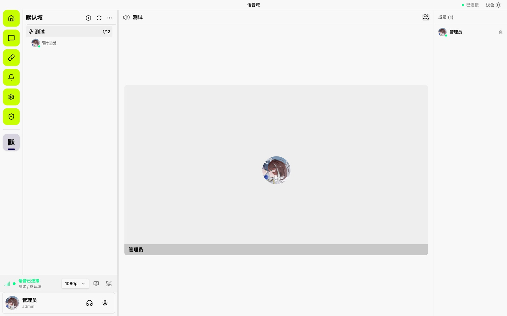
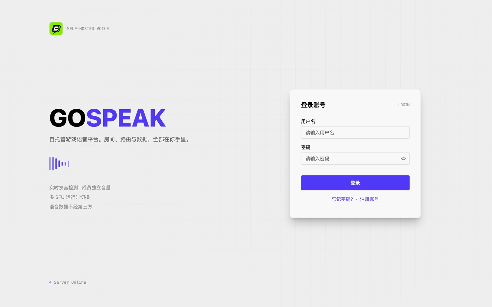

<div align="center">
  

  <h1>GOSpeak</h1>

  <p>
    <a href="https://go.dev" target="_blank"></a>
    <a href="https://react.dev" target="_blank"></a>
    <a href="https://www.livekit.io" target="_blank"></a>
    <a href="https://www.apache.org/licenses/LICENSE-2.0" target="_blank"></a>
    <br />
    <a href="https://awesomemygo.dev/apps/gospeak" target="_blank"></a>
  </p>
</div>

GOSpeak 是一个自托管的游戏语音平台，基于 LiveKit 提供音视频能力。单个二进制即可运行，前端内嵌，提供语音房间、发言检测、逐人音量控制、房间权限与原生桌面客户端。

> **仓库结构**：本仓库是 **monorepo 根** —— 一份 Git 仓库、一份 `pnpm-lock.yaml`、一套 turbo / biome / lefthook 工具链。`server/` `client/` `docs/` 都是仓内普通目录（不是 submodule），直接改、直接提交。
>
> | 目录 | 内容 |
> |---|---|
> | `server/` | `server/`（Go 后端）· `test/`（集成测试）· `docs/`（设计文档） |
> | `client/` | `web/` · `packages/*`（components / sfu-client / desktop / mobile-capabilities / plugin-sdk）· `plugins/*` · `desktop/`（Go + MyGo）· `mobile/`（Capacitor）· `proxyrules/` · `scripts/` |
> | `packages/` | （空）新包预留位，当前只有 `.gitkeep` |
> | `deploy/` | compose · Caddy · LiveKit · 可观测 · 部署脚本 |
> | `docs/` | VitePress 文档站 |
>
> 仓库根一条命令跑通全栈：`pnpm install` → `pnpm dev`（后端 + Web）→ `pnpm build` / `pnpm test` / `pnpm typecheck`。

## 界面预览

<div align="center">
  
  <p><em><strong>语音房间</strong> — 频道树与人数上限、发言检测光圈、成员面板、屏幕共享与分辨率切换</em></p>
</div>

<table>
  <tr>
    <td width="50%" valign="top">
      
      <p><em><strong>登录页</strong> — 自托管实例，无第三方鉴权依赖</em></p>
    </td>
    <td width="50%" valign="top">
      
      <p><em><strong>发现域</strong> — 公开域检索、邀请码加入、已加入域快捷入口</em></p>
    </td>
  </tr>
</table>

## 特性

**语音**

- 语音房间：创建与加入，支持密码保护与人数上限。
- 发言检测：实时语音活动指示，显示当前正在说话的成员。
- 逐人音量：为每位成员单独调节输出音量，设置持久保存。
- 麦克风与静音：一键闭麦、一键静音所有声音。
- 屏幕共享：按需订阅，支持分辨率切换。
- 同源 LiveKit：内置 `/livekit` 反向代理，信令走应用域名，媒体走 WebRTC UDP 直连。

**文字**

- 文字消息：频道与私聊会话，支持提及与表情回应。

**域与权限**

- 发现域：公开域检索、邀请码加入、已加入域快捷入口。
- 邀请码：按域生成、可停用、附使用记录。
- 角色权限：完整的角色权限体系。
- 房间管理：创建者与管理员可强制静音、踢出成员、全员静音。
- 用户禁言：管理员可全局禁言/解禁用户（定时或永久），含媒体层强制状态与实时事件通知。

**部署**

- 单二进制部署：前端通过 `go:embed` 内嵌，下载即用。
- 内置 Caddy：传入域名即可自动申请 HTTPS 证书并处理 WebSocket 升级。
- 渐进式数据库：SQLite、PostgreSQL、MySQL、Turso（libSQL），由 GORM 自动迁移。
- 多种认证方式：JWT 与 OAuth2（GitHub、Google、QQ）。
- 可选组件：对象存储（RustFS、R2）与可观测性（Prometheus、Grafana、Loki）。

**客户端**

- 原生桌面客户端：关窗进托盘、开机自启、全局快捷键、系统通知、游戏内覆盖层，与网页版共用同一套前端。
- 前端错误边界：组件、页面、路由三层兜底与全局错误上报。

## 快速开始

### 单二进制

一条命令装好应用与 LiveKit（自动识别平台、取最新发行包、校验 SHA256）：

```bash
curl -fsSL https://raw.githubusercontent.com/GOSpeak-org/GOSpeak/release/deploy/install-binary.sh | bash
```

默认装到 `/opt/gospeak`，生成 `.env` 与 systemd 服务；重复执行即升级。加 `--dry-run` 只看要下载什么。详见 [单二进制部署](./docs/deploy/binary.md)。

也可以手动从本仓服务端 Release（`gospeak-server-v*`）下载对应平台的 `gospeak-server-v<版本>-<os>-<arch>` 文件，前端已内嵌，无需其他依赖。

```bash
chmod +x gospeak-server-v<VERSION>-linux-amd64
./gospeak-server-v<VERSION>-linux-amd64 server -e prod
```

浏览器打开 `http://<host>:8998`。首次启动自动创建管理员账号，用户名 `admin`，默认密码 `admin123`，生产环境请立即修改。

### 源码开发

需要 Go 1.27.4+、Node.js 22+、pnpm 10+ 与 Docker。monorepo 一次 clone 拿全部：

```bash
git clone https://github.com/GOSpeak-org/GOSpeak.git
cd GOSpeak
pnpm install

# 后端：生成 deploy/.env（含随机 LiveKit 凭证），起依赖后跑服务
cd deploy && ./init.sh && cd ../..
docker compose -f deploy/docker-compose.yml up -d
cd server/server && go run main.go server
```

`./init.sh` 生成唯一配置文件 `deploy/.env`，并随机写入 LiveKit 凭证。全档位版 `docker-compose.standard.yml` 把 7880 绑定到宿主机回环地址供本地直连调试；精简版 `docker-compose.yml` 则是 `7880:7880` 对公网发布，生产勿用。

前端就在同一个仓里：仓库根 `pnpm dev` 同时起前后端，或 `pnpm --filter @gospeak/web dev` 只起 Web；文档站是 `pnpm --filter @gospeak/docs dev`。

## 版本与发行

四端各自独立发版：各有自己的版本真源、tag 与 GitHub Release，互不跟随。版本号只认 `.github/versions/<component>.yaml`，其余副本（`server/VERSION`、各端 `package.json`、`mygo.config.ts`、Android / iOS 原生工程）由 `scripts/release/check-version.mjs` 校验一致性。

| 端 | 版本真源 | Release tag | 主要产物 |
|---|---|---|---|
| 服务端 | `.github/versions/server.yaml` | `gospeak-server-v<版本>` | `gospeak-server-v<版本>-<os>-<arch>` 二进制 + `SHA256SUMS-*.txt` |
| Web | `.github/versions/web.yaml` | `gospeak-web-v<版本>` | `gospeak-web-v<版本>-dist.tar.gz` |
| 桌面端 | `.github/versions/desktop.yaml` | `gospeak-desktop-v<版本>` | dmg / deb / tar.gz / exe 安装包 |
| 移动端 | `.github/versions/mobile.yaml` | `gospeak-mobile-v<版本>` | Android APK |

发版流程：改对应 yaml 的 `version` 与 `notes` → 合入 `release` 分支 → 根 `.github/workflows/` 的发版编排自动打 tag、构建并上传到该端 Release，同时把该端更新日志写进对应的 `CHANGELOG.md`（服务端 `server/CHANGELOG.md`，客户端 `client/{web,desktop,mobile}/CHANGELOG.md`）。

除四端 Release 外，每个发版日主仓还会生成一个按日期命名的**聚合 Release**：tag 形如 `GOSpeak-YYMMDD`（例：`GOSpeak-261128`），正文汇总当次四端各自的产物直链与更新摘要，一次拿齐整套版本。

本仓首次全仓发版：服务端 `1.3.1`，Web / 桌面端 / 移动端 `1.4.1`；更早的 1.x 历史版本入口见各端 `CHANGELOG.md`。

## 部署

完整说明见 [deploy/DEPLOY.md](./deploy/DEPLOY.md)。部署只需要一个域名与一个上游。

### 使用域名

```bash
cd deploy
./init.sh --domain voice.example.com
cd ../..
docker compose -f deploy/docker-compose.standard.yml up -d --build
```

`--domain` 将 `edge` 加入 `COMPOSE_PROFILES`；只有全档位版 `docker-compose.standard.yml` 会读取该变量并启动内置 Caddy 自动申请 HTTPS 证书。浏览器打开 `https://voice.example.com`。精简版 `docker-compose.yml` 不含 Caddy，裸 `docker compose up -d` 不会启用 HTTPS。

### 使用已有反向代理

```bash
cd deploy
./init.sh
cd ../..
docker compose -f deploy/docker-compose.yml up -d --build
```

不传 `--domain`，用精简版即可。将反向代理指向 `gospeak:8998` 这一个上游。`/api`、`/ws`、`/uploads`、`/livekit` 全部由应用提供，LiveKit 不需要单独的域名、证书或代理规则。

内置入口是 Caddy（`deploy/Caddyfile`）：填 `--domain` 时由 `edge` 档位自动签发证书并升级 WebSocket，留空则由你现有的 Nginx / Traefik 等反代接管。已有反代的接法与各类症状排查见 [反向代理文档](./docs/deploy/reverse-proxy.md)。

### 局域网

不传 `--domain`，直接访问 `http://<IP>:8998`。浏览器麦克风需要 localhost 或 HTTPS。

### 端口

放行 `80/443`（反向代理）、`7882/tcp+udp`（媒体）、`3478/udp`（TURN）。全档位版的 7880 仅绑定宿主机回环地址用于本地调试（精简版仍以 `7880:7880` 对公网发布），信令经同源 `/livekit` 代理。

### 可选组件

```env
DB_TYPE="SQLite"                                      # 默认，无外部依赖
DB_TYPE="PostgreSQL"  DB_HOST=postgres  DB_PORT=5432  # 或在 COMPOSE_PROFILES 追加 postgres
DB_TYPE="Turso"      TURSO_DATABASE_URL=...          # libSQL 远程数据库（可选）

# COMPOSE_PROFILES 可选档位
# rustfs         对象存储
# observability  Prometheus + Grafana + Loki
```

## 桌面客户端

桌面客户端与网页版共用同一套前端，提供浏览器不具备的能力：关窗进托盘、全局快捷键（在游戏内生效）、开机自启、系统通知、游戏内覆盖层。构建与开发说明见 [client/desktop/README.md](./client/desktop/README.md) 与 [桌面客户端文档](./docs/guide/desktop.md)。

## 文档

- [部署指南](./server/docs/deployment-guide.md)
- [桌面客户端](./docs/guide/desktop.md)
- [SFU 配置与成熟度](./server/docs/sfu-provider-maturity.md)
- [架构设计](./docs/architecture/index.md)
- [开发者指南](./AGENTS.md) · [服务端模块约定](./server/server/AGENTS.md)
- [文档站源码](./docs/)

## 贡献

欢迎提交 PR 与 Issue，较大的改动请先开 Issue 讨论。提交信息遵循 [Conventional Commits](https://www.conventionalcommits.org/)，由根目录的 commitlint 与 lefthook 钩子强制执行。

## License

Apache 2.0，见 [LICENSE](./LICENSE)。
